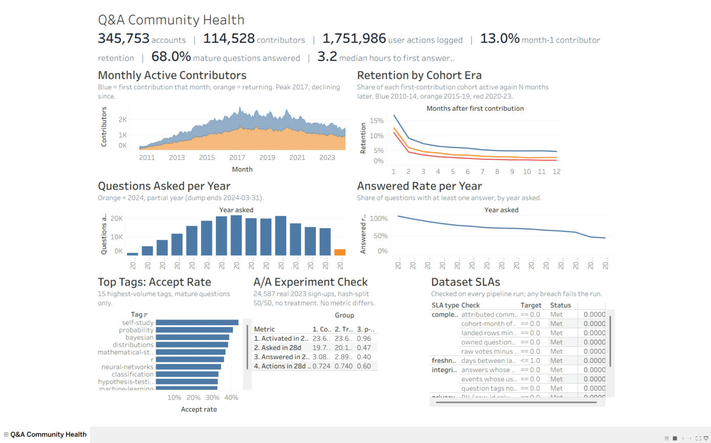

# Community Product Analytics Warehouse

Product-analytics data engineering on a real community Q&A product: logging spec, event model,
dimensional model, product metric marts, dataset SLAs, privacy tiers, an A/A-validated experiment
layer, orchestration, and a Tableau data-story dashboard.

## v2: full Cross Validated history in PySpark (`spark/`)

**Data:** the public Stack Exchange data dump for Cross Validated (stats.stackexchange.com),
Feb 2009 to 2024-03-31, CC BY-SA, downloaded from archive.org (`stats.stackexchange.com.7z`,
SHA-256 `09e73827b20d9161ee3ff3d898dffe0cd9f12c9b79ceaa5d5fea50480ba5c2de`).
Posts, Comments and PostHistory were column-projected on the source machine with
`spark/compact_extract.py` (free text dropped, 3.4 GB of XML to 42 MB); the other five files are
loaded as-is. Landed row counts match the source exactly for all 8 tables (`lake/ops/ingest_audit.json`):
425,735 posts, 1,747,225 votes, 819,648 comments, 1,525,713 post-history rows, 345,754 users,
612,258 badges, 86,919 post links, 1,612 tags (5.56M rows).

```
spark/00_land_raw.py      XML + compact TSV -> typed raw Parquet, ingest audit
spark/01_transform.py     Spark SQL: stg -> quarantine / restricted / analytics (events partitioned by year)
spark/02_sla.py           17 dataset SLAs, results appended to lake/ops/sla_results, breach exits non-zero
spark/03_experiment_aa.py A/A validation of the experiment metrics pipeline
spark/04_ingest_logs.py   Spark ingest of the logging sink, reconciled against the warehouse
spark/05_fingerprint.py   order-independent table fingerprints for cross-environment parity (local vs EMR)
logging_client/           v2 event contracts (JSON Schema), validating logger with dead letter, real-data replay
src/build_tableau.py      Tableau extracts + .twb from the lake
```

Results (all from the lake):
- 1,751,986 attributable user actions from 114,528 contributors; 345,753 accounts.
- Monthly active contributors peaked in 2017 (avg 2,391/month) and fell to 1,567/month in 2023.
- Month-1 contributor retention: 16.9% for 2010-14 cohorts, 12.6% for 2015-19, 11.0% for 2020-23;
  month-12: 4.7%, 2.7%, 1.8%.
- Share of questions answered: 99.1% (2010), 70.1% (2016), 46.6% (2023).
- 148,072 votes reference deleted posts and are quarantined, not dropped.

**Runs on a cluster, with proof of parity.** The same transform ran on AWS EMR Serverless
(emr-7.5.0, Spark 3.5, S3 lake, us-east-1) in 106 s for 0.22 vCPU-hours. `spark/05_fingerprint.py`
hashes every table (row count + sum of xxhash64 over all columns) in both environments. The first
comparison found 20 of 21 tables identical: `agg_question_funnel_yearly` differed because
`percentile_approx` depends on partitioning, so a cluster and a laptop gave different medians. Both
medians now use exact `percentile`, and the rerun matched on all 21 tables (9,527,413 rows).
Job ids, timings and both fingerprints: `lake/ops/emr_parity.json`.

**Event logging, implemented.** A validating logging client (JSON Schema contracts, dedupe,
dead-letter queue) replayed all 3,279,779 historical actions: 1,751,986 accepted and reconciled
exactly with the warehouse (0 mismatches), 1,527,793 (46.6%) rejected for having no actor, 97% of
them anonymous votes. Details: `docs/logging_spec.md` section 6.

**A/A experiment validation.** 24,587 real 2023 sign-ups split 50/50 by salted hash
(12,286 / 12,301, SRM p = 0.9238); outcomes are their real 28-day behaviour and no treatment was applied.
No metric differed (primary: activation 23.60% vs 23.63%, p = 0.9586). Re-drawing the split with
1,000 salts gave false-positive rates of 3.6%, 4.4%, 4.7%, 4.6% at alpha 0.05 (expected 5% +/- 1.35 pts; activation
sits slightly below the band, i.e. conservative), 0 SRM failures, and uniform p-values (KS p > 0.15).

**Data issue caught by an SLA.** The validity check on time-to-first-answer fired on 25 questions whose
first answer predated the question. All 25 are merge destinations (PostHistoryTypeId 38) that inherited
answers from an older duplicate. Time-to-first-answer now counts only answers posted after the question,
merges are flagged, and a new SLA fails if an early answer appears on a non-merged question.

On EMR Serverless: set `CPA_LAKE=s3://<bucket>/lake` and `CPA_CLUSTER=1` (see `lake/ops/emr_parity.json`).

Run locally: `python3 spark/00_land_raw.py <dump_dir> && python3 spark/01_transform.py && python3 spark/02_sla.py && python3 spark/03_experiment_aa.py`

## v1: 19-week launch sample in DuckDB (`src/`, `sql/`, `dags/`)

The original build on Artificial Intelligence Stack Exchange's first 19 weeks (Aug-Dec 2016), kept
as a small, fast dev environment with the Airflow DAG.

## Pipeline

```
raw XML ──ingest.py──> raw.*  (checksum-verified, ops.ingest_audit)
        ──01_staging.sql──> stg.*  + quarantine.*   (typed, orphans quarantined)
        ──02_marts.sql───> analytics.*  (pseudonymous)  restricted.* (PII)
        ──sla.py─────────> ops.sla_results  (13 dataset SLAs, breach fails the run)
```

Orchestrated by `dags/community_product_analytics.py` (Airflow 3.x): ingest → staging → marts →
sla_checks, 2 retries per task, 30-minute task timeout, 2-hour run timeout.

## Model

| Table | Grain |
|---|---|
| `analytics.fct_user_events` | one attributable user action (7 event types) |
| `analytics.dim_user`, `dim_post`, `dim_date`, `bridge_question_tag` | dimensions |
| `analytics.agg_daily_active`, `agg_weekly_active` | active contributors (new vs returning) |
| `analytics.agg_retention_cohort` | first-contribution cohort × week offset (full grid) |
| `analytics.agg_activation` | signup week → first contribution within 7 days |
| `analytics.fct_question_outcomes`, `agg_question_funnel_weekly` | asked → answered → accepted |
| `analytics.agg_tag_health` | answer / accept rate by tag |
| `restricted.user_profile` | PII; owner team only |

Logging spec, event taxonomy, privacy classes and SLA definitions: [`docs/logging_spec.md`](docs/logging_spec.md).

## Results (from the warehouse)

- 3,156 accounts; 479 (15.2%) ever made an attributable contribution.
- Pooled week-1 contributor retention 21.6% (94/435); launch-week cohort 37.9% vs later cohorts 17.5%;
  week 4: 20.7% vs 4.5%.
- Of 395 mature questions (≥14 days old at snapshot end), 89.9% answered and 52.7% accepted;
  median 3.2 h to first answer (1.3 h for launch-week questions, 4.6 h after).
- Logging gaps: only 271 of 5,323 votes (5.1%) carry a voter id; 394 votes (7.4%) reference deleted
  posts and are quarantined; no view events exist, so metrics are contributor actives, not DAU.
- 13/13 SLAs met on the clean build.

## Bug caught during the build

The first retention mart only emitted cohort/week cells that had at least one returning user.
Pooling those rows dropped zero-retention cells from the denominator and overstated later-week
retention (week 3 read 11.1% instead of the correct 6.8%). The mart now builds a full
cohort × offset grid, and an SLA check fails if any cell is missing.

## Tableau dashboard

`tableau/Community_Product_Analytics.twb` (Tableau 2026.2) reads the seven CSV extracts in `tableau/`,
generated from the v2 Spark lake by `src/build_tableau.py`. Dashboard "Q&A Community Health": KPI strip,
monthly active contributors, retention by cohort era, questions asked and answered rate per year,
top-tag accept rates, A/A experiment check, SLA status.
The CSV folder path is set in the workbook; if you move the folder, re-point it via Data > Edit Data Source.

The 2024 points cover Jan-Mar only; some of those questions are under 14 days old, so the 2024
answered rate is not comparable to full years.



v1 dashboard on the 19-week sample: [docs/img/tableau_dashboard.jpg](docs/img/tableau_dashboard.jpg)

## Verification

- `python3 src/pipeline.py`: full build, 13/13 SLAs met.
- `pytest tests`: 23 tests (8 DuckDB + 7 Spark SLA + 8 logging client), including breach tests that inject a duplicate event, a PII column,
  a truncated load and a dropped vote, and confirm the matching SLA fails.
- `airflow dags test community_product_analytics` (Airflow 3.1.8): all 4 tasks succeeded.

## Limits

- 19 weeks of one small site; findings describe this launch, not Q&A products in general.
- Vote and accept timestamps are day-grain; accept actor is derived (only the asker can accept).
- DuckDB has no role-based grants; access tiers are enforced as separate schemas plus the privacy
  SLA. In a warehouse with grants, `restricted` would be granted to the owner role only.
- The salt for `user_key` is a constant in SQL; production would read it from a secrets manager.

## Run

```bash
pip install duckdb pandas pyarrow pytest
python3 src/pipeline.py
python3 -m pytest -q tests
```
