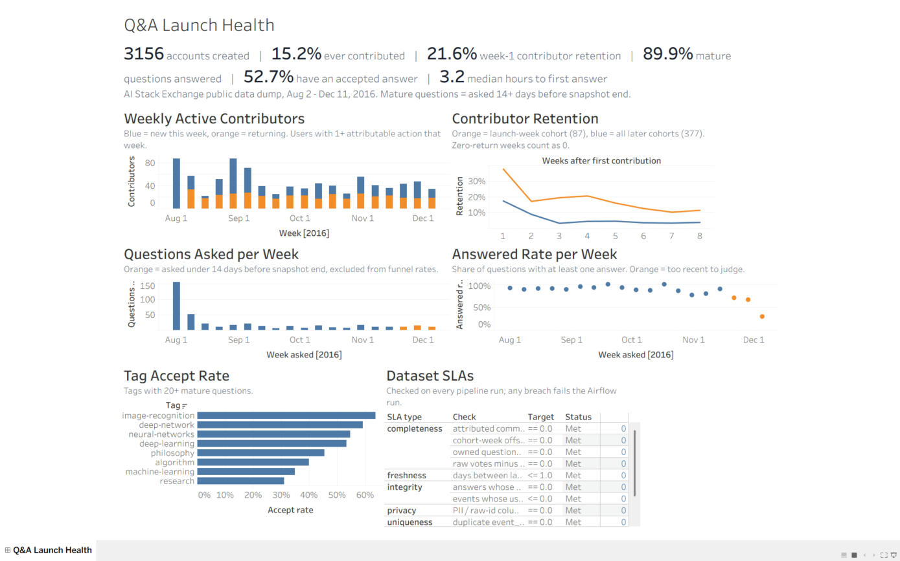

# Community Product Analytics Warehouse

Product-analytics data engineering on a real community Q&A product: logging spec, event model,
star schema, product metric marts, dataset SLAs, privacy tiers, Airflow orchestration, and a
data-story dashboard.

**Data:** public Stack Exchange data dump for Artificial Intelligence Stack Exchange, covering the
site's first 19 weeks (2016-08-02 to 2016-12-11), CC BY-SA. Mirrored in
[`bigdata-vandy/stack-ex`](https://github.com/bigdata-vandy/stack-ex) @ `a9ad674`; every file's
SHA-256 is recorded in `data/SHA256SUMS` and verified at ingest.
Scale: 1,279 posts, 1,165 comments, 5,323 votes, 3,612 post-history rows, 3,157 users.

## Pipeline

```
raw XML ──ingest.py──> raw.*  (checksum-verified, ops.ingest_audit)
        ──01_staging.sql──> stg.*  + quarantine.*   (typed, orphans quarantined)
        ──02_marts.sql───> analytics.*  (pseudonymous)  restricted.* (PII)
        ──sla.py─────────> ops.sla_results  (13 dataset SLAs, breach fails the run)
```

Orchestrated by `dags/community_product_analytics.py` (Airflow 3.x): ingest → staging → marts →
sla_checks, 2 retries per task, 30-minute task timeout, 2-hour run timeout.

## Model

| Table | Grain |
|---|---|
| `analytics.fct_user_events` | one attributable user action (7 event types) |
| `analytics.dim_user`, `dim_post`, `dim_date`, `bridge_question_tag` | dimensions |
| `analytics.agg_daily_active`, `agg_weekly_active` | active contributors (new vs returning) |
| `analytics.agg_retention_cohort` | first-contribution cohort × week offset (full grid) |
| `analytics.agg_activation` | signup week → first contribution within 7 days |
| `analytics.fct_question_outcomes`, `agg_question_funnel_weekly` | asked → answered → accepted |
| `analytics.agg_tag_health` | answer / accept rate by tag |
| `restricted.user_profile` | PII; owner team only |

Logging spec, event taxonomy, privacy classes and SLA definitions: [`docs/logging_spec.md`](docs/logging_spec.md).

## Results (from the warehouse)

- 3,156 accounts; 479 (15.2%) ever made an attributable contribution.
- Pooled week-1 contributor retention 21.6% (94/435); launch-week cohort 37.9% vs later cohorts 17.5%;
  week 4: 20.7% vs 4.5%.
- Of 395 mature questions (≥14 days old at snapshot end), 89.9% answered and 52.7% accepted;
  median 3.2 h to first answer (1.3 h for launch-week questions, 4.6 h after).
- Logging gaps: only 271 of 5,323 votes (5.1%) carry a voter id; 394 votes (7.4%) reference deleted
  posts and are quarantined; no view events exist, so metrics are contributor actives, not DAU.
- 13/13 SLAs met on the clean build.

## Bug caught during the build

The first retention mart only emitted cohort/week cells that had at least one returning user.
Pooling those rows dropped zero-retention cells from the denominator and overstated later-week
retention (week 3 read 11.1% instead of the correct 6.8%). The mart now builds a full
cohort × offset grid, and an SLA check fails if any cell is missing.

## Tableau dashboard

`tableau/Community_Product_Analytics.twb` (Tableau 2026.2) reads the six CSV extracts in `tableau/`,
generated from the warehouse by `src/build_tableau.py`. Dashboard "Q&A Launch Health": KPI strip,
weekly active contributors, cohort retention, questions asked, answered rate, tag accept rate, SLA status.
The CSV folder path is set in the workbook; if you move the folder, re-point it via Data > Edit Data Source.



## Verification

- `python3 src/pipeline.py`: full build, 13/13 SLAs met.
- `pytest tests`: 8 tests, including breach tests that inject a duplicate event, a PII column,
  a truncated load and a dropped vote, and confirm the matching SLA fails.
- `airflow dags test community_product_analytics` (Airflow 3.1.8): all 4 tasks succeeded.

## Limits

- 19 weeks of one small site; findings describe this launch, not Q&A products in general.
- Vote and accept timestamps are day-grain; accept actor is derived (only the asker can accept).
- DuckDB has no role-based grants; access tiers are enforced as separate schemas plus the privacy
  SLA. In a warehouse with grants, `restricted` would be granted to the owner role only.
- The salt for `user_key` is a constant in SQL; production would read it from a secrets manager.

## Run

```bash
pip install duckdb pandas pyarrow pytest
python3 src/pipeline.py
python3 -m pytest -q tests
```
